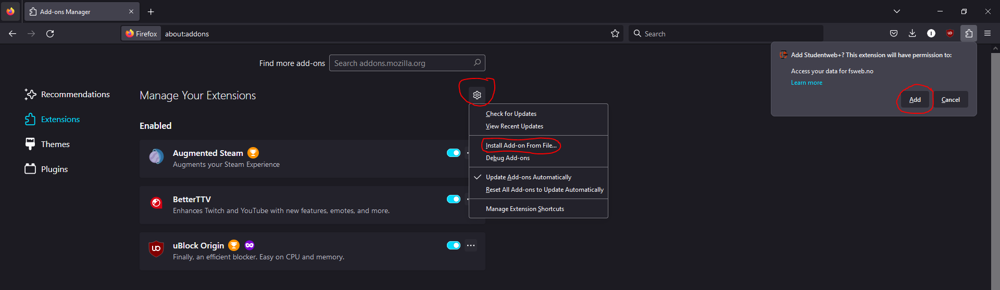

# Studentweb+
Simple extension for Mozilla Firefox that calculates grade average and displays it in a readable format. 

## Installation

Head over to [releases](https://github.com/ivannorderhaug/studentwebplus/releases) and download the latest version of Studentweb+. 

Then search for **about:addons** in the search bar. Once there click on the "gear" icon and a dropdown menu should appear. Select the option "Install Add-on From File" and navigate to the location of where the 
studentwebplus-x.x.x.xpi is located. Select it and click "Open".

Finally click "Add" on the popup that appears.

If the extension appears on the addons page, then you've succesfully installed Studentweb+

## Usage

Navigate to Studentweb and log in. Once you're logged in, navigate to the "Results" tab. There will be a new button present in the navigation bar called "Studentweb+". Click on it and you'll be provided with a menu with the following inputs: "Study", which is just the name of the study. Call it whatever you want. "Start" which is the start year of your programme and "End" which is the end year of your programme.

## Limitations
The extension has only been tested on a limited amount of people, meaning there are bound to be certain edge cases that haven't been accounted for. If you encounter any bugs or issues, please report them in the issues tab and I'll try to fix them as soon as possible. As the project is open source, feel free to contribute to the project by submitting a pull request should you want the fix or feature to be implemented faster.
